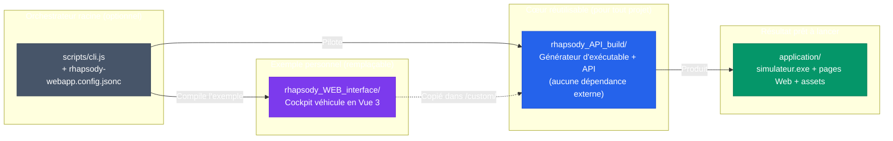
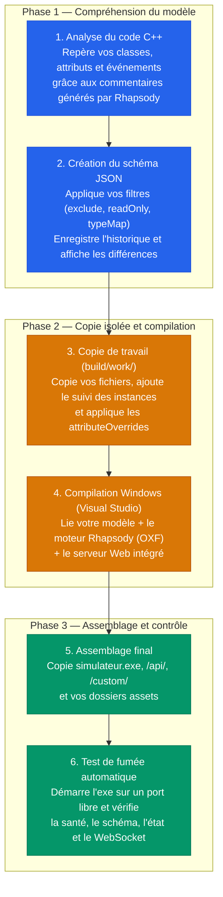
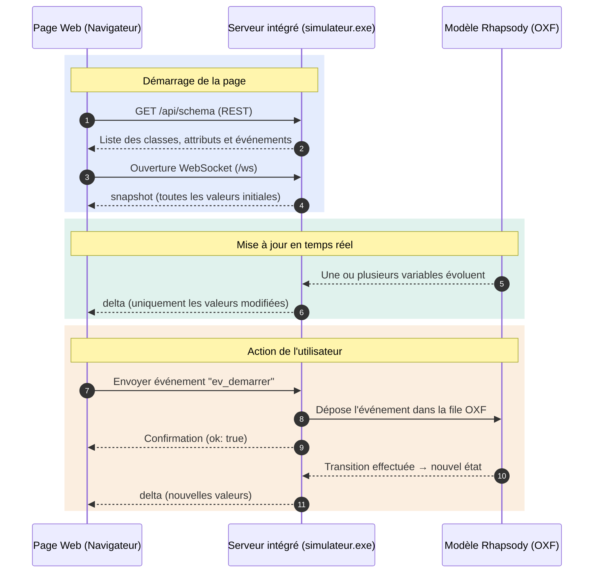
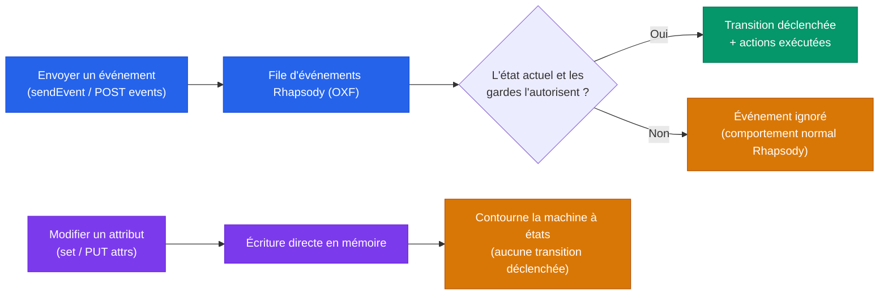

# Description détaillée — Chaîne de construction et API Rhapsody

Ce document complète le **`Tutoriel`** rapide. Il explique, avec un vocabulaire accessible, **comment fonctionne la chaîne d'outils**, **comment la personnaliser** pour votre projet IBM Rhapsody, **comment utiliser l'API en détail**, et **comment diagnostiquer les erreurs courantes**.

> **Rappel sur le contenu du dépôt :** le dossier `rhapsody_WEB_interface/` (cockpit véhicule) et les chemins pré-remplis dans les fichiers de configuration constituent **un exemple personnel concret**. Toute la mécanique décrite ci-dessous (`rhapsody_API_build/`) est totalement indépendante de cet exemple et s'applique à n'importe quel modèle Rhapsody C++.

<!-- TOC -->

<details><summary>Table des matières</summary>
<span class="fo">&ensp;&ensp;</span><b>• <a href="#1-glossaire">1. Glossaire</a></b><br>
<span class="fo">&ensp;&ensp;</span><b>• <a href="#2-organisation-g%C3%A9n%C3%A9rale-du-d%C3%A9p%C3%B4t">2. Organisation générale du dépôt</a></b><br>
<span class="fo">&ensp;&ensp;</span><b>• <a href="#3-la-cha%C3%AEne-de-construction-en-d%C3%A9tail">3. La chaîne de construction en détail</a></b><br>
<span class="fo">&ensp;&ensp;</span>&ensp;&ensp;&ensp;&ensp;◦ <a href="#31-ce-quil-faut-retenir-de-chaque-phase">3.1. Ce qu'il faut retenir de chaque phase</a><br>
<span class="fo">&ensp;&ensp;</span><b>• <a href="#4-fonctionnement-en-ex%C3%A9cution--donn%C3%A9es-rest-et-websocket">4. Fonctionnement en exécution : données, REST et WebSocket</a></b><br>
<span class="fo">&ensp;&ensp;</span>&ensp;&ensp;&ensp;&ensp;◦ <a href="#41-attributs-vs-%C3%A9v%C3%A9nements--une-distinction-cruciale">4.1. Attributs vs Événements : une distinction cruciale</a><br>
<span class="fo">&ensp;&ensp;</span>&ensp;&ensp;&ensp;&ensp;◦ <a href="#42-identifiants-dinstances-et-types-pris-en-charge">4.2. Identifiants d'instances et types pris en charge</a><br>
<span class="fo">&ensp;&ensp;</span><b>• <a href="#5-personnaliser-le-syst%C3%A8me-via-la-configuration">5. Personnaliser le système via la configuration</a></b><br>
<span class="fo">&ensp;&ensp;</span>&ensp;&ensp;&ensp;&ensp;◦ <a href="#51-les-r%C3%A9glages-les-plus-utiles">5.1. Les réglages les plus utiles</a><br>
<span class="fo">&ensp;&ensp;</span>&ensp;&ensp;&ensp;&ensp;◦ <a href="#52-adapter-un-chemin-de-fichier-sans-toucher-au-mod%C3%A8le-attributeoverrides">5.2. Adapter un chemin de fichier sans toucher au modèle (attributeOverrides)</a><br>
<span class="fo">&ensp;&ensp;</span>&ensp;&ensp;&ensp;&ensp;◦ <a href="#53-commandes-pratiques-au-quotidien">5.3. Commandes pratiques au quotidien</a><br>
<span class="fo">&ensp;&ensp;</span>&ensp;&ensp;&ensp;&ensp;◦ <a href="#54-surcharges-au-lancement-sans-recompiler">5.4. Surcharges au lancement (sans recompiler)</a><br>
<span class="fo">&ensp;&ensp;</span><b>• <a href="#6-r%C3%A9f%C3%A9rence-de-lapi-rest-websocket-et-sim-clientjs">6. Référence de l'API (REST, WebSocket et sim-client.js)</a></b><br>
<span class="fo">&ensp;&ensp;</span>&ensp;&ensp;&ensp;&ensp;◦ <a href="#61-option-simple--sim-clientjs">6.1. Option simple : sim-client.js</a><br>
<span class="fo">&ensp;&ensp;</span>&ensp;&ensp;&ensp;&ensp;◦ <a href="#62-routes-rest-api">6.2. Routes REST (/api/...)</a><br>
<span class="fo">&ensp;&ensp;</span>&ensp;&ensp;&ensp;&ensp;◦ <a href="#63-messages-websocket-ws">6.3. Messages WebSocket (/ws)</a><br>
<span class="fo">&ensp;&ensp;</span>&ensp;&ensp;&ensp;&ensp;◦ <a href="#64-embarquer-un-site-personnalis%C3%A9-custom">6.4. Embarquer un site personnalisé (/custom/)</a><br>
<span class="fo">&ensp;&ensp;</span><b>• <a href="#7-comprendre-les-erreurs-et-conna%C3%AEtre-les-limites">7. Comprendre les erreurs et connaître les limites</a></b><br>
<span class="fo">&ensp;&ensp;</span>&ensp;&ensp;&ensp;&ensp;◦ <a href="#71-diagnostiquer-les-erreurs-fr%C3%A9quentes">7.1. Diagnostiquer les erreurs fréquentes</a><br>
<span class="fo">&ensp;&ensp;</span>&ensp;&ensp;&ensp;&ensp;◦ <a href="#72-limites-techniques-%C3%A0-conna%C3%AEtre">7.2. Limites techniques à connaître</a>
</details>

<!-- /TOC -->

---

## 1. Glossaire

| N° | Terme | Explication simple |
| :---: | --- | --- |
| <a id="g-api"></a>**1** | **API** | Ensemble de points d'entrée permettant à une interface Web (ou un autre programme) de lire des données et d'envoyer des commandes à `simulateur.exe`. |
| <a id="g-attribut"></a>**2** | **Attribut** | Variable membre d'une classe Rhapsody (ex. une vitesse, un compteur, un voyant). |
| <a id="g-cors"></a>**3** | **CORS** | Mécanisme de sécurité des navigateurs Web qui bloque par défaut les échanges entre deux adresses différentes. L'outil l'autorise (`cors: true`) pour que votre page HTML locale puisse parler à `127.0.0.1:8080`. |
| <a id="g-delta"></a>**4** | **Delta / Snapshot** | Un *snapshot* est une photo complète de toutes les variables à la connexion ; un *delta* ne contient que les variables qui viennent de changer. |
| <a id="g-evenement"></a>**5** | **Événement** | Signal envoyé à une machine à états (*statechart*) Rhapsody via la file OXF pour déclencher une transition. |
| <a id="g-instrumentation"></a>**6** | **Instrumentation** | Ajout automatique de quelques lignes techniques (sur une copie du code) pour observer les objets et exposer leurs variables. |
| <a id="g-json"></a>**7** | **JSON / JSONC** | Format de fichier texte structuré sous forme `"clé": valeur`. Le JSONC autorise en plus les commentaires (`// ...`). |
| <a id="g-node"></a>**8** | **Node.js / npm** | Programme installé sur votre PC (`Node.js`) et son lanceur de commandes (`npm`) utilisés pour piloter la compilation et le serveur de développement. |
| <a id="g-oxf"></a>**9** | **OXF** | *Object Execution Framework* : la bibliothèque interne d'IBM Rhapsody qui fait tourner les machines à états, les timers et la file d'événements. |
| <a id="g-port"></a>**10** | **Port (ex. `8080`)** | Numéro de « porte » réseau locale sur votre PC qui permet au navigateur d'atteindre `simulateur.exe`. |
| <a id="g-rest"></a>**11** | **REST** | Style d'API utilisant des requêtes Web classiques (`GET` pour lire, `PUT`/`PATCH` pour modifier, `POST` pour déclencher une action). |
| <a id="g-schema"></a>**12** | **Schéma JSON** | Carte d'identité de votre modèle générée au build : liste toutes les classes, attributs, types et événements accessibles via l'API. |
| <a id="g-smoke"></a>**13** | **Test de fumée (*smoke test*)** | Vérification rapide et automatique lancée en fin de build pour s'assurer que l'exécutable démarre et répond correctement. |
| <a id="g-token"></a>**14** | **Token** | Clé secrète optionnelle exigée par le serveur pour empêcher n'importe quelle page Web d'envoyer des commandes à votre simulateur. |
| <a id="g-ws"></a>**15** | **WebSocket** | Canal de communication bidirectionnel permanent entre le navigateur et l'exécutable, utilisé pour recevoir les changements en temps réel. |

---

## 2. Organisation générale du dépôt

Le dépôt est découpé en trois parties bien distinctes :

<!-- paysage : zoom = 100, direction = LR -->
<!-- portrait : zoom = 85, direction = TB -->


- **`rhapsody_API_build/`** : c'est le véritable outil générique. Il suffit à lui seul pour compiler votre modèle Rhapsody avec son API<sup><a href="#g-api" title="Glossaire : API">[1]</a></sup> et y embarquer n'importe quelle page Web.
- **`rhapsody_WEB_interface/`** : mon interface personnelle de démonstration (cockpit de voiture). Vous n'avez pas besoin d'y toucher si vous créez votre propre site.
- **Racine (`scripts/cli.js` + `rhapsody-webapp.config.jsonc`)** : un lanceur pratique qui coordonne les deux sous-projets et propose des commandes utiles comme `npm run dev:api` (recompilation automatique dès que Rhapsody regénère le code).

---

## 3. La chaîne de construction en détail

Lorsque vous lancez un build (`npm run build`), l'outil exécute **6 étapes automatiques** sans jamais modifier votre projet Rhapsody d'origine.

<!-- paysage : zoom = 100, direction = TB -->
<!-- portrait : zoom = 80, direction = TB -->


### 3.1. Ce qu'il faut retenir de chaque phase

1. **Analyse automatique** : IBM Rhapsody insère automatiquement des balises de commentaires standard dans le code C++ qu'il génère (`//## class`, `//## attribute`, `//## event`). L'outil s'appuie dessus : dès que vous ajoutez ou supprimez un attribut<sup><a href="#g-attribut" title="Glossaire : Attribut">[2]</a></sup> dans Rhapsody puis regénérez le code, le build suivant met automatiquement l'API<sup><a href="#g-api" title="Glossaire : API">[1]</a></sup> à jour.
2. **Schéma JSON<sup><a href="#g-schema" title="Glossaire : Schéma JSON">[12]</a></sup> horodaté** : à chaque build, un fichier `api_schema.<date>.json` est créé. Il liste tout ce que l'API<sup><a href="#g-api" title="Glossaire : API">[1]</a></sup> expose et indique dans le terminal ce qui a changé depuis le build précédent (attributs<sup><a href="#g-attribut" title="Glossaire : Attribut">[2]</a></sup> ajoutés, supprimés ou modifiés).
3. **Isolation complète (`build/work/`)** : le code est toujours copié avant d'être modifié. L'outil y ajoute un petit mécanisme de suivi qui enregistre chaque instance créée en mémoire, et adapte automatiquement la fonction `main()` si vous avez généré le code en mode *Animation* dans Rhapsody.
4. **Détection automatique des outils** : l'outil trouve lui-même Visual Studio (`vcvars64.bat`) et lit le fichier `.mak` généré par Rhapsody pour localiser les bibliothèques du moteur **OXF**<sup><a href="#g-oxf" title="Glossaire : OXF">[9]</a></sup> (*Object Execution Framework*, le cœur d'exécution de Rhapsody).
5. **Test de fumée<sup><a href="#g-smoke" title="Glossaire : Test de fumée (smoke test)">[13]</a></sup> (*smoke test*<sup><a href="#g-smoke" title="Glossaire : Test de fumée (smoke test)">[13]</a></sup>)** : juste après la compilation, l'exécutable est lancé en arrière-plan quelques secondes pour prouver que le serveur répond bien avant d'afficher `BUILD SUCCEEDED`.

---

## 4. Fonctionnement en exécution : données, REST et WebSocket

Au lancement de `simulateur.exe`, le serveur local démarre automatiquement en parallèle de votre modèle Rhapsody et ouvre le navigateur. Il combine **deux modes de communication complémentaires** :

- **REST<sup><a href="#g-rest" title="Glossaire : REST">[11]</a></sup> (HTTP)** : idéal pour les actions ponctuelles (récupérer le schéma<sup><a href="#g-schema" title="Glossaire : Schéma JSON">[12]</a></sup> au démarrage, lire une valeur précise, redémarrer la simulation, ou piloter depuis un script Python/`curl`).
- **WebSocket**<sup><a href="#g-ws" title="Glossaire : WebSocket">[15]</a></sup> : une connexion ouverte en permanence entre la page Web et l'exécutable. Dès qu'une variable change dans votre modèle, l'exécutable pousse uniquement la différence (**delta**<sup><a href="#g-delta" title="Glossaire : Delta / Snapshot">[4]</a></sup>) vers le navigateur (jusqu'à 20 fois par seconde par défaut).

<!-- paysage : zoom = 100 -->
<!-- portrait : zoom = 85 -->


### 4.1. Attributs vs Événements : une distinction cruciale

Dans Rhapsody, un objet réactif possède à la fois des **attributs**<sup><a href="#g-attribut" title="Glossaire : Attribut">[2]</a></sup> (ses variables) et une **machine à états** (*statechart*) pilotée par des **événements**<sup><a href="#g-evenement" title="Glossaire : Événement">[5]</a></sup>. L'API<sup><a href="#g-api" title="Glossaire : API">[1]</a></sup> n'agit pas de la même manière sur les deux :

<!-- paysage : zoom = 100, direction = LR -->
<!-- portrait : zoom = 85, direction = TB -->


- Utilisez les **événements**<sup><a href="#g-evenement" title="Glossaire : Événement">[5]</a></sup> pour toutes les commandes utilisateur (démarrer, cliquer un bouton, lancer une action).
- Utilisez la **modification d'attributs**<sup><a href="#g-attribut" title="Glossaire : Attribut">[2]</a></sup> pour régler des paramètres continus (masse, pente, seuil, consigne de capteur) ou forcer une valeur pendant un test.

### 4.2. Identifiants d'instances et types pris en charge

- **Nommage des instances** : la première instance vivante d'une classe `MaClasse` s'appelle `"MaClasse"`. S'il y en a plusieurs, les suivantes se nomment `"MaClasse#2"`, `"MaClasse#3"`, etc. `"MaClasse"` désigne toujours la plus ancienne instance encore vivante.
- **Types C++ reconnus automatiquement** : `bool`, nombres entiers (`int`, `long`, `unsigned`, etc.), `enum`, nombres décimaux (`float`, `double`), chaînes de caractères (`OMString`, `std::string`, `char[N]`) et tableaux fixes de ces types.
- **Ce qui n'est pas exposé directement** : les types complexes/structures personnalisées (listés dans `skipped` du schéma<sup><a href="#g-schema" title="Glossaire : Schéma JSON">[12]</a></sup>) et les opérations/méthodes C++ (pour déclencher une opération depuis le Web, passez par un événement<sup><a href="#g-evenement" title="Glossaire : Événement">[5]</a></sup> Rhapsody).

---

## 5. Personnaliser le système via la configuration

Toute la personnalisation se fait dans **`rhapsody_API_build/rhapsody-api.config.jsonc`** (ou dans **`rhapsody-webapp.config.jsonc`** si vous utilisez les commandes à la racine).

### 5.1. Les réglages les plus utiles

| Besoin | Clé de configuration | Exemple concret |
| --- | --- | --- |
| Pointer vers votre projet Rhapsody | `projectDir` + `codeDir` | `"projectDir": "C:/Projets/MonApp"`, `"codeDir": "CodesGeneres/ModeAnimation"` |
| Changer le nom de l'exécutable | `exe` | `"./dist/mon_simu.exe"` |
| Changer le port<sup><a href="#g-port" title="Glossaire : Port (ex. 8080)">[10]</a></sup> ou ouvrir sur le réseau local | `server.host`, `server.port` | `"host": "0.0.0.0"`, `"port": 9000` |
| Protéger l'API<sup><a href="#g-api" title="Glossaire : API">[1]</a></sup> par un mot de passe (clé) | `server.token` | `"token": "mon_secret"` (exigé en `?token=...` ou `Authorization: Bearer`) |
| Ajuster la fluidité temps réel | `server.pushRateHz` | `20` (mises à jour max par seconde, de 1 à 1000) |
| Masquer des éléments internes | `exclude` | `{ "classes": [], "attributes": ["tmp_*"], "events": [] }` |
| Protéger certains attributs<sup><a href="#g-attribut" title="Glossaire : Attribut">[2]</a></sup> en lecture seule | `readOnly` | `["MaClasse.compteur"]` |
| Exposer un type C++ personnalisé (`typedef`) | `typeMap` | `{ "T_Vitesse": "float", "T_Code": "int" }` |
| Embarquer des fichiers externes (sons, images…) | `assets` + `run.useExeDir` | `"assets": [{ "from": "sons", "to": "sons" }]`, `"useExeDir": true` |
| Changer la valeur initiale d'un attribut<sup><a href="#g-attribut" title="Glossaire : Attribut">[2]</a></sup> pour l'exe | `attributeOverrides` | Voir ci-dessous |
| Choisir les routes des sites embarqués | `web.route`, `customWeb.route` | `"/api"` (page générique) et `"/custom"` (votre site) |

### 5.2. Adapter un chemin de fichier sans toucher au modèle (`attributeOverrides`)

Cas très fréquent : dans Rhapsody, votre code charge un fichier audio ou de données depuis un chemin qui fonctionne sur votre PC (par exemple `C:\MesProjets\sons\`), mais qui ne fonctionnera plus si vous donnez `simulateur.exe` à quelqu'un d'autre.

La solution se fait en deux lignes de configuration, **sans rien changer dans Rhapsody** :

1. Copiez le dossier à côté de l'exécutable avec `assets` et activez `run.useExeDir: true` (pour que l'exécutable cherche toujours les chemins relatifs dans son propre dossier).
2. Remplacez la valeur initiale de l'attribut<sup><a href="#g-attribut" title="Glossaire : Attribut">[2]</a></sup> **uniquement dans la copie compilée** :

<!-- code:extrait-config.jsonc -->
```jsonc
"assets": [
  { "from": "sons", "to": "sons" }
],
"attributeOverrides": [
  {
    "class": "MaClasse",         // facultatif si le nom d'attribut est unique
    "attribute": "chemin_sons",
    "type": "OMString",          // OMString, std::string, bool, int, float ou double
    "value": "sons\\"
  }
]
```

> **Condition** : l'attribut<sup><a href="#g-attribut" title="Glossaire : Attribut">[2]</a></sup> doit être initialisé dans le constructeur C++ généré par Rhapsody (ce que Rhapsody fait automatiquement quand vous donnez une *Initial Value* à un attribut<sup><a href="#g-attribut" title="Glossaire : Attribut">[2]</a></sup>).

### 5.3. Commandes pratiques au quotidien

| Où lancer la commande | Commande | Utilité |
| --- | --- | --- |
| Dans `rhapsody_API_build/` | `npm run schema` | Vérifie ce qui est détecté dans votre modèle **sans compiler** |
| Dans `rhapsody_API_build/` | `npm run build` | Compile l'exécutable + exécute le test de fumée<sup><a href="#g-smoke" title="Glossaire : Test de fumée (smoke test)">[13]</a></sup> |
| Dans `rhapsody_API_build/` | `npm run build -- --verbose` | Affiche tous les messages du compilateur (utile en cas d'erreur) |
| Dans `rhapsody_API_build/` | `npm run run` | Lance l'exécutable généré |
| Dans `rhapsody_API_build/` | `npm run clean` | Supprime la copie de travail temporaire (`build/work`) |
| À la racine du dépôt | `npm run dev:api` | Surveille votre dossier Rhapsody : **reconstruit et relance automatiquement** l'exécutable dès que vous regénérez le code |
| À la racine du dépôt | `npm run build:api` | Recompile l'exécutable en gardant votre site dans `custom_web_interface/` et copie tout dans `application/` |

### 5.4. Surcharges au lancement (sans recompiler)

Vous pouvez aussi modifier le comportement de `simulateur.exe` au moment de le lancer :

- **`--api-port=9000`** ou variable **`RHAPSODY_API_PORT=9000`** : utilise un autre port<sup><a href="#g-port" title="Glossaire : Port (ex. 8080)">[10]</a></sup> ;
- **`--api-host=0.0.0.0`** ou variable **`RHAPSODY_API_HOST=0.0.0.0`** : rend le serveur accessible sur le réseau local ;
- **`RHAPSODY_API_NO_BROWSER=1`** : empêche l'ouverture automatique du navigateur ;
- **`RHAPSODY_API_DISABLE=1`** : lance le modèle Rhapsody seul, sans serveur Web.

---

## 6. Référence de l'API (REST, WebSocket et `sim-client.js`)

### 6.1. Option simple : `sim-client.js`

Servi automatiquement sur `/api/sim-client.js`, il encapsule la connexion WebSocket<sup><a href="#g-ws" title="Glossaire : WebSocket">[15]</a></sup>, la reconnexion automatique et le maintien de l'état local :

- `new SimClient({ url?, token? })` : par défaut, se connecte à la même adresse que la page (`location.origin`).
- `await sim.schema` : récupère la description complète du modèle.
- `sim.onState((state, changes) => ...)` : appelé à la connexion (`changes === null`) puis à chaque mise à jour.
- `sim.onStatus((connected) => ...)` / `sim.onInstances((list) => ...)` / `sim.onEvent((msg) => ...)`.
- `sim.set(instance, attr, value, index?)` et `sim.setMany({ Inst: { a: 1, b: 2 } })`.
- `sim.sendEvent(nom, args?, instance?)` et `sim.reset()`.

### 6.2. Routes REST (`/api/...`)

Utilisables depuis n'importe quel outil ou langage (`fetch`, Python, `curl`…) :

| Requête | Corps JSON<sup><a href="#g-json" title="Glossaire : JSON / JSONC">[7]</a></sup> | Rôle |
| --- | --- | --- |
| `GET /api/health` | — | État du serveur (`ok`, durée de fonctionnement, instances) |
| `GET /api/schema` | — | Schéma<sup><a href="#g-schema" title="Glossaire : Schéma JSON">[12]</a></sup> complet du modèle (classes, attributs<sup><a href="#g-attribut" title="Glossaire : Attribut">[2]</a></sup>, types, événements<sup><a href="#g-evenement" title="Glossaire : Événement">[5]</a></sup>) |
| `GET /api/instances` | — | Liste des instances vivantes |
| `GET /api/state` | — | Valeurs actuelles de tous les attributs<sup><a href="#g-attribut" title="Glossaire : Attribut">[2]</a></sup> de toutes les instances |
| `GET /api/instances/{id}/attrs/{attr}` | — | Lit un attribut<sup><a href="#g-attribut" title="Glossaire : Attribut">[2]</a></sup> précis |
| `PUT /api/instances/{id}/attrs/{attr}` | `{"value": 42}` *(ou `{"value": "x", "index": 1}` pour un tableau)* | Modifie un attribut<sup><a href="#g-attribut" title="Glossaire : Attribut">[2]</a></sup> |
| `PATCH /api/instances/{id}/attrs` | `{"a": 1, "b": true}` | Modifie plusieurs attributs<sup><a href="#g-attribut" title="Glossaire : Attribut">[2]</a></sup> d'une instance |
| `PATCH /api/state` | `{"MaClasse": {"a": 1}}` | Modifie plusieurs attributs<sup><a href="#g-attribut" title="Glossaire : Attribut">[2]</a></sup> sur plusieurs instances |
| `POST /api/events/{nom}` | `{"arg": 1}` ou `[1]` ou `{}` | Envoie l'événement<sup><a href="#g-evenement" title="Glossaire : Événement">[5]</a></sup> à l'unique instance qui le gère |
| `POST /api/instances/{id}/events/{nom}` | `{"arg": 1}` ou `[1]` ou `{}` | Envoie l'événement<sup><a href="#g-evenement" title="Glossaire : Événement">[5]</a></sup> à une instance précise |
| `POST /api/reset` | *(aucun)* | Redémarre la simulation depuis l'état initial (`409` si déjà en cours) |

### 6.3. Messages WebSocket (`/ws`)

- **Reçus du serveur** :
  - `snapshot` : état complet envoyé à l'ouverture de la connexion ;
  - `delta` : uniquement les attributs<sup><a href="#g-attribut" title="Glossaire : Attribut">[2]</a></sup> modifiés (`changes`) et les instances ajoutées/retirées (`added`/`removed`) ;
  - `event` : notification d'un événement<sup><a href="#g-evenement" title="Glossaire : Événement">[5]</a></sup> ;
  - `result` : réponse (`ok: true/false`, `reqId`, `error?`) à une commande envoyée par le client.
- **Envoyés par le client** :
  - `{"op": "set", "instance": "MaClasse", "attr": "vitesse", "value": 42, "reqId": 1}`
  - `{"op": "event", "name": "ev_action", "args": {"param": 1}, "reqId": 2}`
  - `{"op": "reset", "reqId": 3}` (ou `"snapshot"`, `"schema"`, `"ping"`).

### 6.4. Embarquer un site personnalisé (`/custom/`)

Tout fichier déposé dans `rhapsody_API_build/custom_web_interface/` est copié à côté de l'exécutable et servi sur `/custom/` (et la racine `/` y redirige automatiquement). Un fichier optionnel `site.json` (`{ "api": { "host": "127.0.0.1", "port": 8080, "token": "" } }`) dans ce dossier permet d'aligner automatiquement l'adresse d'écoute de l'exécutable sur celle attendue par votre site.

---

## 7. Comprendre les erreurs et connaître les limites

### 7.1. Diagnostiquer les erreurs fréquentes

| Message ou symptôme | Ce que cela signifie | Comment corriger |
| --- | --- | --- |
| `vcvars64.bat not found` | Le compilateur C++ de Visual Studio n'a pas été trouvé | Installez la charge *Développement Desktop en C++* dans Visual Studio, ou indiquez le chemin dans `build.vcvarsPath` |
| `OMROOT not found` ou `frameworkLibRoot` introuvable | L'outil ne trouve pas les fichiers du framework Rhapsody | Regénérez le code dans Rhapsody (pour créer le `.mak`), ou renseignez `build.rhapsodyRoot` / `build.frameworkLibRoot` |
| Erreur sur des bibliothèques `Release` manquantes | Rhapsody n'a souvent que les bibliothèques `Debug` installées | Gardez `"buildType": "Debug"` dans `rhapsody-api.config.jsonc` |
| `Skipped attribute ... Use "typeMap"` | L'attribut<sup><a href="#g-attribut" title="Glossaire : Attribut">[2]</a></sup> utilise un type personnalisé (`typedef`) inconnu de l'API<sup><a href="#g-api" title="Glossaire : API">[1]</a></sup> | Ajoutez `"typeMap": { "MonType": "int" }` (ou `float`, `bool`, `string`) dans la config |
| L'événement<sup><a href="#g-evenement" title="Glossaire : Événement">[5]</a></sup> répond `ok: true` mais rien ne change | L'événement<sup><a href="#g-evenement" title="Glossaire : Événement">[5]</a></sup> a bien été livré à Rhapsody, mais la machine à états l'a ignoré | Vérifiez dans Rhapsody que le modèle est dans le bon état et que les gardes de la transition sont vraies |
| Un son ou fichier externe ne se charge pas dans l'exe | Le chemin relatif ne pointe pas au bon endroit | Ajoutez le dossier dans `assets`, activez `run.useExeDir: true`, et adaptez le chemin initial avec `attributeOverrides` |
| Le navigateur reste « Déconnecté » ou le port<sup><a href="#g-port" title="Glossaire : Port (ex. 8080)">[10]</a></sup> échoue | Une ancienne instance de `simulateur.exe` tourne encore en arrière-plan | Fermez l'ancienne fenêtre de `simulateur.exe` (ou tuez le processus dans le Gestionnaire des tâches) |

### 7.2. Limites techniques à connaître

- **Windows uniquement** : le build utilise Visual Studio (`cl.exe`) et les bibliothèques Windows d'IBM Rhapsody.
- **Accès concurrents en mémoire** : le serveur lit et écrit les attributs<sup><a href="#g-attribut" title="Glossaire : Attribut">[2]</a></sup> sans bloquer les threads Rhapsody. C'est sans souci pour les nombres et booléens, avec un faible risque de lecture incohérente sur les textes (`OMString`) modifiés très vite.
- **Sécurité réseau** : par défaut, l'API<sup><a href="#g-api" title="Glossaire : API">[1]</a></sup> n'accepte que les connexions venant de votre propre PC (`127.0.0.1`) et autorise le **CORS**<sup><a href="#g-cors" title="Glossaire : CORS">[3]</a></sup> (`*`, ce qui permet d'ouvrir un fichier HTML local directement). Si vous ouvrez le serveur sur le réseau (`0.0.0.0`), définissez toujours un `server.token`.
- **Objets copiés** : les instances créées par constructeur de copie C++ ne sont pas suivies automatiquement.
