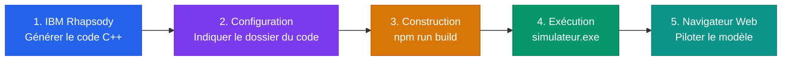
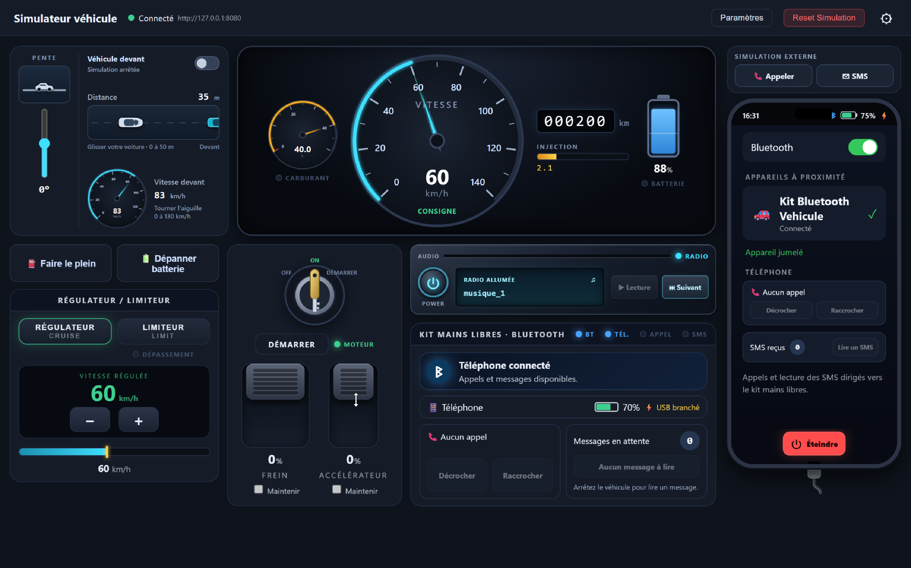
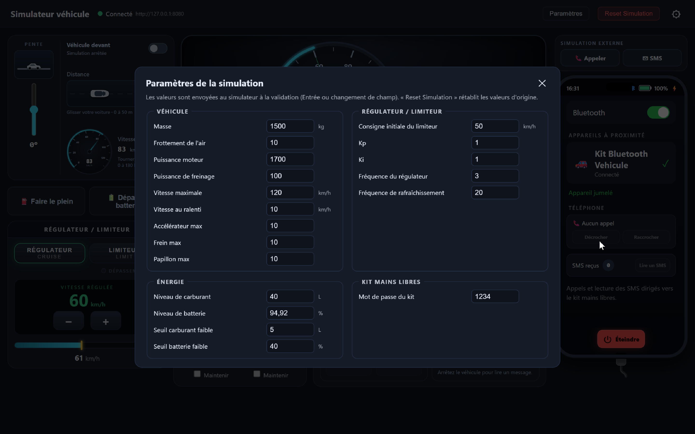
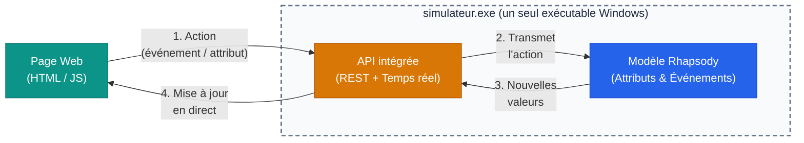

# Tutoriel - Ajouter une interface Web à un projet Rhapsody

Ce guide pratique décrit, étape par étape, comment transformer un **projet IBM Rhapsody** en un **exécutable Windows autonome** pilotable depuis un navigateur Web - sans jamais modifier le modèle Rhapsody d'origine.

Tous les fichiers et outils mentionnés dans ce document proviennent du dépôt GitHub **[https://github.com/benoitdekeyn/rhapsody_webapp_builder](https://github.com/benoitdekeyn/rhapsody_webapp_builder)** :

- **Présentation générale du dépôt** : [README.md](https://github.com/benoitdekeyn/rhapsody_webapp_builder/blob/main/README.md)
- **Récupérer le projet** : [Télécharger le ZIP](https://github.com/benoitdekeyn/rhapsody_webapp_builder/archive/refs/heads/main.zip) ou cloner via `git clone https://github.com/benoitdekeyn/rhapsody_webapp_builder.git`

> **Pour comprendre le fonctionnement interne ou personnaliser finement l'outil**, consulter le document comlémentaire **[Description_detaillee.md](https://github.com/benoitdekeyn/rhapsody_webapp_builder/blob/main/tutoriel/Description_detaillee.md)** (également disponible en HTML et PDF dans le dossier `tutoriel/` du dépôt).

<!-- TOC -->

<details><summary>Table des matières</summary>
<span class="fo">&ensp;&ensp;</span><b>• <a href="#1-mini-glossaire">1. Mini-glossaire</a></b><br>
<span class="fo">&ensp;&ensp;</span><b>• <a href="#2-%C3%A0-quoi-sert-cet-outil-">2. À quoi sert cet outil ?</a></b><br>
<span class="fo">&ensp;&ensp;</span>&ensp;&ensp;&ensp;&ensp;◦ <a href="#21-vue-densemble-des-%C3%A9tapes">2.1. Vue d'ensemble des étapes</a><br>
<span class="fo">&ensp;&ensp;</span><b>• <a href="#3-essayer-lexemple-tout-de-suite-sans-rien-installer">3. Essayer l'exemple tout de suite (sans rien installer)</a></b><br>
<span class="fo">&ensp;&ensp;</span><b>• <a href="#4-pr%C3%A9requis--installer-nodejs-une-seule-fois">4. Prérequis : installer Node.js (une seule fois)</a></b><br>
<span class="fo">&ensp;&ensp;</span><b>• <a href="#5-construire-lex%C3%A9cutable-pour-un-projet-rhapsody">5. Construire l'exécutable pour un projet Rhapsody</a></b><br>
<span class="fo">&ensp;&ensp;</span>&ensp;&ensp;&ensp;&ensp;◦ <a href="#51-%C3%A9tape-1--g%C3%A9n%C3%A9rer-le-code-dans-rhapsody">5.1. Étape 1 - Générer le code dans Rhapsody</a><br>
<span class="fo">&ensp;&ensp;</span>&ensp;&ensp;&ensp;&ensp;◦ <a href="#52-%C3%A9tape-2--indiquer-le-projet-dans-la-configuration">5.2. Étape 2 - Indiquer le projet dans la configuration</a><br>
<span class="fo">&ensp;&ensp;</span>&ensp;&ensp;&ensp;&ensp;◦ <a href="#53-%C3%A9tape-3--lancer-la-construction">5.3. Étape 3 - Lancer la construction</a><br>
<span class="fo">&ensp;&ensp;</span>&ensp;&ensp;&ensp;&ensp;◦ <a href="#54-%C3%A9tape-4--lancer-le-simulateur-et-tester">5.4. Étape 4 - Lancer le simulateur et tester</a><br>
<span class="fo">&ensp;&ensp;</span><b>• <a href="#6-connecter-une-interface-web-personnalis%C3%A9e-%C3%A0-lapi">6. Connecter une interface Web personnalisée à l'API</a></b><br>
<span class="fo">&ensp;&ensp;</span>&ensp;&ensp;&ensp;&ensp;◦ <a href="#61-parcours-simplifi%C3%A9-des-donn%C3%A9es">6.1. Parcours simplifié des données</a><br>
<span class="fo">&ensp;&ensp;</span>&ensp;&ensp;&ensp;&ensp;◦ <a href="#62-cr%C3%A9er-une-premi%C3%A8re-page-web-en-2-minutes">6.2. Créer une première page Web (en 2 minutes)</a><br>
<span class="fo">&ensp;&ensp;</span>&ensp;&ensp;&ensp;&ensp;◦ <a href="#63-embarquer-le-site-dans-simulateurexe">6.3. Embarquer le site dans simulateur.exe</a><br>
<span class="fo">&ensp;&ensp;</span><b>• <a href="#7-%C3%A0-propos-du-dossier-rhapsody_web_interface-facultatif">7. À propos du dossier rhapsody_WEB_interface/ (facultatif)</a></b><br>
<span class="fo">&ensp;&ensp;</span><b>• <a href="#8-commandes-npm-utiles">8. Commandes npm utiles</a></b><br>
<span class="fo">&ensp;&ensp;</span>&ensp;&ensp;&ensp;&ensp;◦ <a href="#81-dans-le-dossier-rhapsody_api_build">8.1. Dans le dossier rhapsody_API_build/</a><br>
<span class="fo">&ensp;&ensp;</span>&ensp;&ensp;&ensp;&ensp;◦ <a href="#82-%C3%A0-la-racine-du-d%C3%A9p%C3%B4t-rhapsody_webapp_builder">8.2. À la racine du dépôt (rhapsody_webapp_builder/)</a>
</details>

<!-- /TOC -->

---

## 1. Mini-glossaire

| N° | Terme | Explication simple |
| :---: | --- | --- |
| <a id="g-api"></a>**1** | **API** | Interface d'échange qui permet à deux programmes (ici le navigateur Web et `simulateur.exe`) de discuter ensemble. |
| <a id="g-rest"></a>**2** | **API REST** | Façon standard de demander ou d'envoyer une information ponctuelle à travers des adresses Web (ex. `/api/state`, `/api/events/ev_demarrer`). |
| <a id="g-attribut"></a>**3** | **Attribut** | Variable d'une classe Rhapsody (ex. une vitesse, un compteur, un voyant). |
| <a id="g-evenement"></a>**4** | **Événement** | Signal envoyé à une machine à états (*statechart*) Rhapsody pour déclencher une transition (ex. `ev_demarrer`). |
| <a id="g-html"></a>**5** | **HTML / CSS / JS** | Les trois langages standards du Web : HTML (structure de la page), CSS (mise en forme et couleurs) et JS / JavaScript (interactivité et appels à l'API). |
| <a id="g-json"></a>**6** | **JSON / JSONC** | Format de fichier texte simple pour écrire des réglages sous forme `"clé": valeur`. Le JSONC autorise en plus les commentaires (`// ...`). |
| <a id="g-node"></a>**7** | **Node.js / npm** | Programme installé sur le PC (`Node.js`) et son lanceur de commandes (`npm`) utilisés pour exécuter `npm run build`, `npm run run`, etc. |
| <a id="g-oxf"></a>**8** | **OXF** | *Object Execution Framework* : le moteur interne d'IBM Rhapsody qui gère l'exécution des classes, les temporisations et la file d'événements. |
| <a id="g-port"></a>**9** | **Port (ex. `8080`)** | Numéro de « porte » sur le PC qui permet au navigateur de trouver le bon programme local (`127.0.0.1:8080`). |
| <a id="g-schema"></a>**10** | **Schéma JSON** | Fichier généré automatiquement qui liste toutes les classes, attributs et événements détectés dans le modèle Rhapsody. |
| <a id="g-vue"></a>**11** | **Vue 3 / Vite** | Outils Web modernes utilisés dans l'exemple personnel `rhapsody_WEB_interface/` pour créer des composants visuels et les regrouper en un seul fichier HTML. |
| <a id="g-ws"></a>**12** | **WebSocket** | Connexion permanente entre la page Web et `simulateur.exe` qui permet de recevoir les nouvelles valeurs en direct, sans recharger la page. |

---

## 2. À quoi sert cet outil ?

Habituellement, un modèle s'exécute directement dans l'interface d'IBM Rhapsody. L'outil **`rhapsody_API_build`** reprend le code C++ déjà généré par Rhapsody et fabrique un **exécutable Windows** (`simulateur.exe`) qui :

1. fait tourner la **simulation Rhapsody** exactement comme d'habitude ;
2. ouvre automatiquement le navigateur sur une **interface Web** connectée en direct au modèle.

> **À propos de l'interface de voiture incluse dans le dépôt :**
> Le dossier `rhapsody_WEB_interface/` (cockpit de voiture) ainsi que les chemins pré-remplis dans les fichiers de configuration correspondent à un **projet personnel fourni uniquement comme exemple concret**.
> L'outil `rhapsody_API_build` fonctionne sur **n'importe quel projet Rhapsody** : il permet de créer une page Web (même toute simple) et de la brancher sur n'importe quel modèle.

### 2.1. Vue d'ensemble des étapes

<!-- paysage : zoom = 100, direction = LR -->
<!-- portrait : zoom = 80, direction = TB -->


---

## 3. Essayer l'exemple tout de suite (sans rien installer)

Pour découvrir le résultat final avant de commencer :

1. Récupérer le dépôt depuis GitHub ([télécharger le ZIP](https://github.com/benoitdekeyn/rhapsody_webapp_builder/archive/refs/heads/main.zip) et le décompresser, ou cloner [le dépôt](https://github.com/benoitdekeyn/rhapsody_webapp_builder)).
2. Ouvrir le dossier `application/` à la racine du dépôt.
3. Double-cliquer sur **`simulateur.exe`**.
4. Le navigateur s'ouvre sur `http://127.0.0.1:8080/custom/` (exemple personnel de cockpit véhicule).
5. Ouvrir également **`http://127.0.0.1:8080/api/`** : c'est la **page générique** générée automatiquement pour tout projet (elle affiche tous les attributs<sup><a href="#g-attribut" title="Glossaire : Attribut">[3]</a></sup> et boutons d'événements<sup><a href="#g-evenement" title="Glossaire : Événement">[4]</a></sup> sans écrire une ligne de HTML<sup><a href="#g-html" title="Glossaire : HTML / CSS / JS">[5]</a></sup>).

Voici un aperçu de l'interface graphique Web d'exemple pilotant le simulateur C++ Rhapsody (`http://127.0.0.1:8080/custom/`) :



Il est également possible d'y réinitialiser la simulation ou de régler des attributs<sup><a href="#g-attribut" title="Glossaire : Attribut">[3]</a></sup> (constants ou variables) directement depuis la fenêtre de paramètres :



---

## 4. Prérequis : installer Node.js (une seule fois)

Le projet IBM Rhapsody est supposé déjà prêt et compilable sur le PC. Le seul programme supplémentaire à installer est **Node.js<sup><a href="#g-node" title="Glossaire : Node.js / npm">[7]</a></sup> (version 22 ou plus)**, qui fournit la commande `npm` utilisée pour lancer la construction.

1. Télécharger la version **LTS** sur <https://nodejs.org/fr/download> et lancer l'installateur (conserver toutes les options par défaut).
2. Ouvrir un terminal (**clic droit dans un dossier → Ouvrir dans le terminal**), puis vérifier :

```powershell
npm -v
```

L'affichage d'un numéro de version confirme que l'installation est prête. *(Si un message indique que `npm` n'est pas reconnu, fermer complètement le terminal puis le rouvrir.)*

> **Rien d'autre à installer** : l'outil `rhapsody_API_build` ne télécharge aucune bibliothèque externe.

---

## 5. Construire l'exécutable pour un projet Rhapsody

### 5.1. Étape 1 - Générer le code dans Rhapsody

Dans **IBM Rhapsody**, générer le code C++ du projet comme d'habitude (*Code → Generate / Make / Run*). Les fichiers `.h`, `.cpp` et `.mak` se trouvent dans le dossier `CodesGeneres/ModeAnimation` du projet.

### 5.2. Étape 2 - Indiquer le projet dans la configuration

Ouvrir le fichier **[`rhapsody_API_build/rhapsody-api.config.jsonc`](https://github.com/benoitdekeyn/rhapsody_webapp_builder/blob/main/rhapsody_API_build/rhapsody-api.config.jsonc)** (avec le Bloc-notes ou VS Code) et adapter les champs ci-dessous pour pointer vers le projet cible :

<!-- code:rhapsody_API_build/rhapsody-api.config.jsonc -->
```jsonc
{
  // Remplacer par le dossier principal du projet Rhapsody
  "projectDir": "C:/Chemin/Vers/MonProjetRhapsody",

  // Dossier contenant le code C++ généré par Rhapsody
  "codeDir": "CodesGeneres/ModeAnimation",

  // Nom de l'exécutable qui sera créé
  "exe": "./dist/simulateur.exe",

  // Copie le dossier "sons" du projet à côté de simulateur.exe
  "assets": [
    { "from": "sons", "to": "sons" }
  ],

  // Remplace le chemin des sons UNIQUEMENT dans l'exécutable compilé
  "attributeOverrides": [
    { "class": "_SysVehicule", "attribute": "chemin_sons", "type": "OMString", "value": "sons\\" }
  ],

  // Lance toujours l'exécutable depuis son propre dossier (pour trouver "sons\")
  "run": {
    "useExeDir": true
  }
}
```

> **Important - Faire fonctionner la lecture de fichiers (sons, images, données) dans l'exécutable :**
> Si le projet Rhapsody lit des fichiers externes (par exemple des `.wav` dans un dossier `sons/`), trois réglages garantissent que tout fonctionne même après déplacement de `simulateur.exe` :
> 1. **`assets`** copie le dossier (ex. `sons`) juste à côté de `simulateur.exe`.
> 2. **`run.useExeDir: true`** force l'exécutable à chercher les chemins relatifs dans son propre dossier.
> 3. **`attributeOverrides`** remplace la valeur initiale de l'attribut<sup><a href="#g-attribut" title="Glossaire : Attribut">[3]</a></sup> de chemin (ex. `chemin_sons` → `"sons\\"`) **uniquement dans l'exécutable compilé**, sans modifier le projet Rhapsody. Adapter `"class"` et `"attribute"` au nom de la classe et de l'attribut<sup><a href="#g-attribut" title="Glossaire : Attribut">[3]</a></sup> concernés (ou mettre `[]` si le projet n'utilise aucun fichier externe).

### 5.3. Étape 3 - Lancer la construction

1. Ouvrir un terminal **dans le dossier `rhapsody_API_build/`**.
2. Lancer la commande de construction :

```powershell
npm run build
```

L'outil analyse le code Rhapsody, compile l'exécutable et vérifie automatiquement son démarrage. En fin d'exécution, le message **`BUILD SUCCEEDED`** doit apparaître.

### 5.4. Étape 4 - Lancer le simulateur et tester

Dans le même terminal, exécuter :

```powershell
npm run run
```

Le navigateur s'ouvre sur **`http://127.0.0.1:8080/api/`** : toutes les classes, les valeurs des attributs<sup><a href="#g-attribut" title="Glossaire : Attribut">[3]</a></sup> en temps réel et les boutons permettant de déclencher les événements<sup><a href="#g-evenement" title="Glossaire : Événement">[4]</a></sup> Rhapsody sont immédiatement accessibles.

> **Astuce pratique** : après une modification du modèle dans Rhapsody, regénérer le code dans Rhapsody puis relancer simplement `npm run build`. Le projet Rhapsody d'origine n'est **jamais** modifié par l'outil.

---

## 6. Connecter une interface Web personnalisée à l'API

Une fois `simulateur.exe` lancé, toute page Web peut communiquer avec lui à travers son **API**<sup><a href="#g-api" title="Glossaire : API">[1]</a></sup> (une passerelle d'échange de données locale sur le PC).

### 6.1. Parcours simplifié des données

<!-- paysage : zoom = 100, direction = LR -->
<!-- portrait : zoom = 85, direction = TB -->


### 6.2. Créer une première page Web (en 2 minutes)

L'outil fournit un fichier prêt à l'emploi, **`sim-client.js`**, qui prend en charge toute la communication avec l'exécutable.

Créer un fichier **`index.html`** avec le contenu suivant, remplacer `MaClasse`, `ma_variable` et `ev_mon_evenement` par les noms du modèle Rhapsody, puis l'ouvrir dans un navigateur pendant que `simulateur.exe` tourne :

<!-- code:index.html -->
```html
<!doctype html>
<html lang="fr">
<head>
  <meta charset="utf-8">
  <title>Mon interface Rhapsody</title>
</head>
<body>
  <h1>Pilotage de la simulation</h1>
  <p>Connexion : <strong id="etat">Déconnecté</strong></p>
  <p>Valeur actuelle : <strong id="valeur">--</strong></p>

  <button id="btnEvent">Déclencher un événement</button>
  <button id="btnModif">Mettre la valeur à 50</button>
  <button id="btnReset">Redémarrer la simulation</button>

  <!-- Connexion automatique à l'API de simulateur.exe -->
  <script src="http://127.0.0.1:8080/api/sim-client.js"></script>
  <script>
    const sim = new SimClient({ url: "http://127.0.0.1:8080" });

    // Affiche si la page est bien reliée à simulateur.exe
    sim.onStatus((ok) => {
      document.getElementById("etat").textContent = ok ? "Connecté" : "Déconnecté";
    });

    // Met à jour l'affichage dès qu'un attribut change dans Rhapsody
    sim.onState((state) => {
      const obj = state["MaClasse"];
      if (obj) document.getElementById("valeur").textContent = obj.ma_variable;
    });

    // Actions des boutons
    document.getElementById("btnEvent").onclick = () => sim.sendEvent("ev_mon_evenement");
    document.getElementById("btnModif").onclick = () => sim.set("MaClasse", "ma_variable", 50);
    document.getElementById("btnReset").onclick = () => sim.reset();
  </script>
</body>
</html>
```

#### Les actions essentielles à retenir

| Action en JavaScript<sup><a href="#g-html" title="Glossaire : HTML / CSS / JS">[5]</a></sup> | Effet dans Rhapsody |
| --- | --- |
| `sim.onState((state) => { ... })` | Reçoit automatiquement les valeurs des attributs<sup><a href="#g-attribut" title="Glossaire : Attribut">[3]</a></sup> en temps réel |
| `sim.sendEvent("ev_nom")` | Envoie un événement<sup><a href="#g-evenement" title="Glossaire : Événement">[4]</a></sup> (comme dans Rhapsody ; agit si la machine à états l'autorise) |
| `sim.sendEvent("ev_nom", { arg: 12 })` | Envoie un événement<sup><a href="#g-evenement" title="Glossaire : Événement">[4]</a></sup> avec paramètre(s) |
| `sim.set("MaClasse", "attribut", 42)` | Change directement la valeur d'un attribut<sup><a href="#g-attribut" title="Glossaire : Attribut">[3]</a></sup> en mémoire |
| `sim.reset()` | Redémarre la simulation à zéro |

### 6.3. Embarquer le site dans `simulateur.exe`

Pour que le site s'ouvre **automatiquement** au double-clic sur `simulateur.exe` :

1. Copier le fichier `index.html` (ainsi que les éventuels fichiers CSS / JS<sup><a href="#g-html" title="Glossaire : HTML / CSS / JS">[5]</a></sup> / images) dans le dossier **`rhapsody_API_build/custom_web_interface/`**.
2. Dans un terminal ouvert dans `rhapsody_API_build/`, relancer :

```powershell
npm run build
```

Le dossier `rhapsody_API_build/dist/` contient désormais un simulateur autonome : un double-clic sur `simulateur.exe` ouvre directement l'interface Web personnalisée (sur `/custom/`).

---

## 7. À propos du dossier `rhapsody_WEB_interface/` (facultatif)

Le dossier **[`rhapsody_WEB_interface/`](https://github.com/benoitdekeyn/rhapsody_webapp_builder/tree/main/rhapsody_WEB_interface)** présent à la racine du dépôt joue un rôle bien précis :

- **Contenu** : il s'agit du code source de **l'interface personnelle d'exemple** (le cockpit de voiture), construit avec des outils Web modernes (**Vue 3 + Vite**<sup><a href="#g-vue" title="Glossaire : Vue 3 / Vite">[11]</a></sup>) qui regroupent tout le site en un seul fichier `dist/index.html` autonome. Il contient un dossier `src/core/` (connexion à l'API<sup><a href="#g-api" title="Glossaire : API">[1]</a></sup>), un fichier `api-map.jsonc` (correspondance entre les noms de l'interface et les attributs<sup><a href="#g-attribut" title="Glossaire : Attribut">[3]</a></sup>/événements<sup><a href="#g-evenement" title="Glossaire : Événement">[4]</a></sup> Rhapsody) et les composants visuels de la voiture (`src/car/`).
- **Aucune obligation de s'y pencher** : pour créer une simple page `index.html` (comme montré plus haut) ou un site avec d'autres outils, ce dossier peut être totalement ignoré en déposant les fichiers directement dans `rhapsody_API_build/custom_web_interface/`.
- **Réutilisation possible comme base** : cet environnement Web est déjà configuré pour développer confortablement. L'utilisateur peut s'en inspirer - ou remplacer son contenu par sa propre interface - afin de profiter de la chaîne complète depuis la racine du dépôt :
  - **`npm run dev`** : ouvre l'interface en mode développement ; à chaque sauvegarde, la page se recharge automatiquement tout en restant connectée à `simulateur.exe`.
  - **`npm run update:web`** : recompile l'interface et remplace celle de `application/` **sans même fermer `simulateur.exe`** (un simple rafraîchissement du navigateur suffit).
  - **`npm run build`** : enchaîne tout automatiquement en une seule commande - compile `rhapsody_WEB_interface/`, copie le résultat dans `rhapsody_API_build/custom_web_interface/`, compile `simulateur.exe` et place l'application complète dans `application/`.

> **Note** : lors de la toute première exécution de `npm run dev` ou `npm run build` à la racine avec `rhapsody_WEB_interface/`, les dépendances Web de Vue/Vite<sup><a href="#g-vue" title="Glossaire : Vue 3 / Vite">[11]</a></sup> s'installent automatiquement (une connexion Internet est alors nécessaire uniquement cette fois-là).

---

## 8. Commandes `npm` utiles

Selon que le terminal est ouvert dans **`rhapsody_API_build/`** (utilisation du générateur d'API<sup><a href="#g-api" title="Glossaire : API">[1]</a></sup> seul) ou **à la racine du dépôt** (commandes de développement automatique incluses), voici les commandes disponibles :

### 8.1. Dans le dossier `rhapsody_API_build/`

| Commande | Utilité |
| --- | --- |
| `npm run build` | Analyse le code Rhapsody, compile `simulateur.exe` et vérifie son démarrage |
| `npm run build -- --verbose` | Même chose en affichant tous les détails du compilateur (utile en cas d'erreur) |
| `npm run run` | Lance `simulateur.exe` et ouvre le navigateur |
| `npm run schema` | Analyse le code Rhapsody **sans compiler** pour vérifier les attributs<sup><a href="#g-attribut" title="Glossaire : Attribut">[3]</a></sup> et événements<sup><a href="#g-evenement" title="Glossaire : Événement">[4]</a></sup> détectés |
| `npm run clean` | Supprime les fichiers temporaires de compilation (`build/work/`) |
| `npm test` | Lance les tests automatiques de l'outil (et de l'exécutable s'il est compilé) |

### 8.2. À la racine du dépôt (`rhapsody_webapp_builder/`)

Ces commandes utilisent le fichier `rhapsody-webapp.config.jsonc` et copient automatiquement le résultat final dans `application/`.

| Commande | Utilité |
| --- | --- |
| `npm run dev:api` | **Mode développement Rhapsody** : surveille le dossier généré et **reconstruit + relance automatiquement** `simulateur.exe` dès que le code est regénéré dans Rhapsody |
| `npm run build:api` | Compile `simulateur.exe` avec le site déjà présent dans `custom_web_interface/` et met à jour `application/` |
| `npm run run` | Lance `application/simulateur.exe` |
| `npm run schema` | Analyse le code Rhapsody et met à jour uniquement le schéma JSON<sup><a href="#g-schema" title="Glossaire : Schéma JSON">[10]</a></sup> |
| `npm run clean` | Nettoie les fichiers temporaires (ajouter `-- --all` pour supprimer aussi `application/` et les exécutables) |
| `npm run build` | *(Exemple complet)* Compile l'interface Web de démonstration (`rhapsody_WEB_interface/`) **puis** `simulateur.exe` |
| `npm run dev` | *(Exemple complet)* Lance le serveur de développement de l'interface Web avec rechargement automatique à chaque sauvegarde |
| `npm run update:web` | *(Exemple complet)* Recompile l'interface Web et la met à jour dans `application/` **sans arrêter** `simulateur.exe` |
